<h1 align="center">Claude Desktop Pet</h1>

<p align="center">
  A tiny pixel Claude that lives on your desktop and reacts to everything <a href="https://claude.com/claude-code">Claude Code</a> is doing.<br>
  Thinking, reading, writing, running tests, failing, finishing, or just waiting for you.
</p>


<p align="center">
  <a href="docs/claude-desktop-pet-promo.mp4">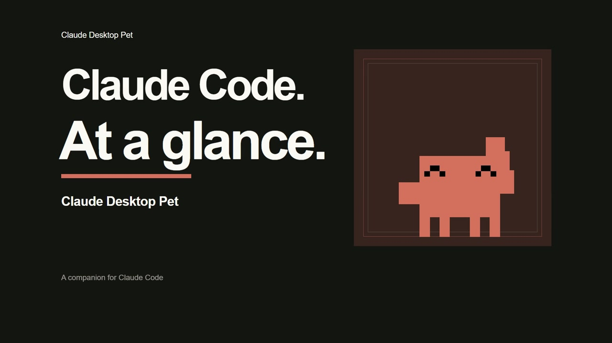</a><br>
  <sub><a href="docs/claude-desktop-pet-promo.mp4"><b>Watch the 55-second promo</b></a> · Sound on · Live activity, sessions, helpers, usage, weather and effects</sub>
</p>

<p align="center">
  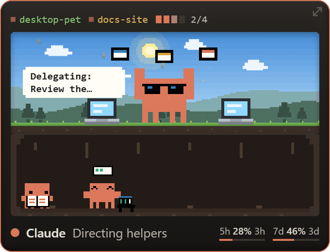<br>
</p>

<p align="center">
  
  
  
</p>

## What it does

A small always-on-top card sits in the corner of your screen. Whatever Claude Code is up to, the pet acts it out, with a speech bubble saying what it's touching right now.

The pet and its helpers use the extended pixel activities from [Mascot Studio v1.7.0](https://github.com/Harriszed/mascot-studio/tree/v1.7.0), with the earlier v1.6.0 walk restored. When idle, Claude randomly switches between stretching, looking around and a quiet breath, without repeating the same animation immediately. Breathing and looking around are each slightly more likely than stretching. Each finishes one or two complete loops; live activity interrupts it. Reduced motion stops idle switching. Delegating Claude puts on shades and conducts floating task cards; actual sub-agents appear separately below. Idle gags play their full 10–14 second sequences; incoming Claude Code activity interrupts them.

Sleeping uses [Mascot Studio v1.7.2](https://github.com/Harriszed/mascot-studio/tree/v1.7.2)'s blue nightcap, gentle bob and drifting Zs.

<p align="center">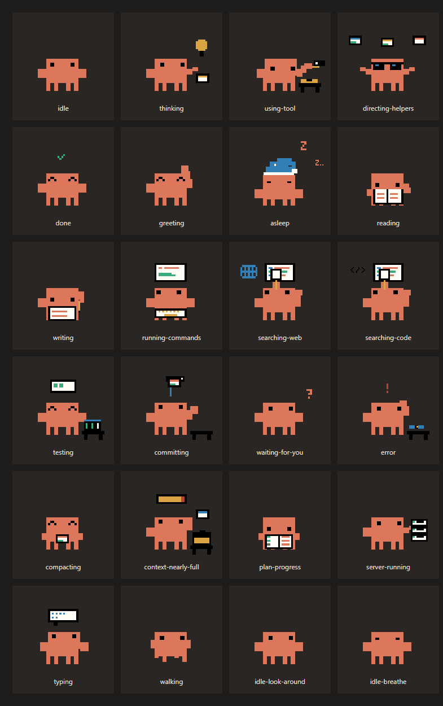</p>

- **Runs off your Claude Code hooks.** It just listens, no file watching.
- **Speech bubbles** show the current action (`Editing App.tsx`, `npm test`, `Build failed`).
- **Multiple sessions.** Several Claude Code windows show as coloured chips; click one to jump to that window.
- **Task progress.** A little bar follows Claude's to-do list.
- **Usage at a glance.** 5-hour and 7-day usage with time until reset. Set **Settings > Claude Code > Usage refresh** to 1, 5 or 15 minutes, or 1 hour; the default is 5 minutes.
- **Context warning.** Tells you when a session's memory is nearly full.
- **Sub-agents.** Helpers appear as tiny Claudes underneath; click one for details.
- **Local weather and time of day** change the scenery behind it.
- **Random gags.** Every so often, when idle, it does something silly. See below.

<p align="center">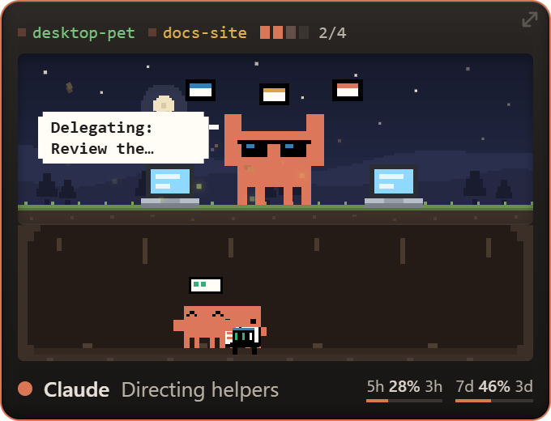</p>

## Random gags

When Claude is idle, it occasionally does an AI-flavoured bit. Ten so far:

<table align="center">
<tr>
<td align="center">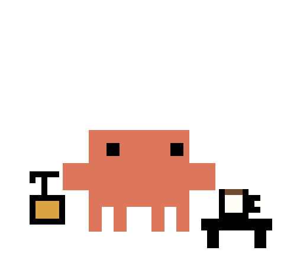<br><sub>Coffee. Always coffee.</sub></td>
<td align="center">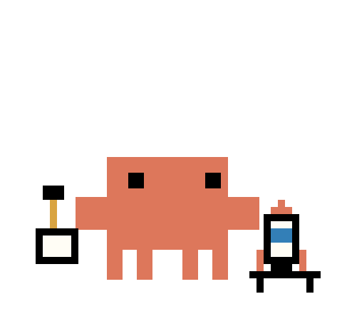<br><sub>Deploying to prod...</sub></td>
</tr>
<tr>
<td align="center">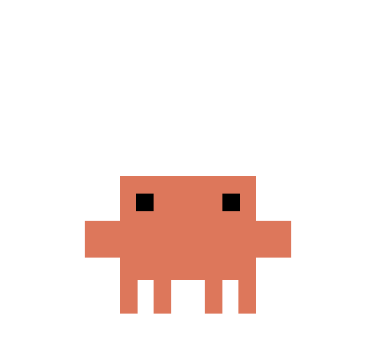<br><sub>*ships it*</sub></td>
<td align="center">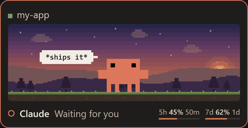<br><sub>Buffering...</sub></td>
</tr>
<tr>
<td align="center">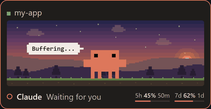<br><sub>Totally real. Trust me.</sub></td>
<td align="center">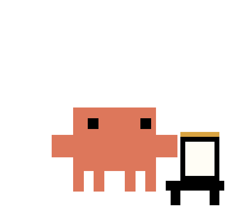<br><sub>Counting tokens...</sub></td>
</tr>
<tr>
<td align="center">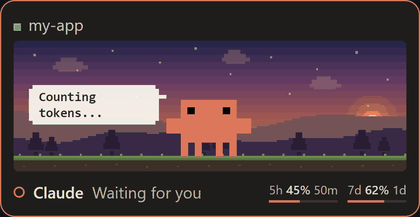<br><sub>Context window: feeling full</sub></td>
<td align="center">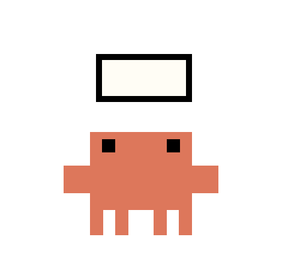<br><sub>Thinking really hard...</sub></td>
</tr>
<tr>
<td align="center">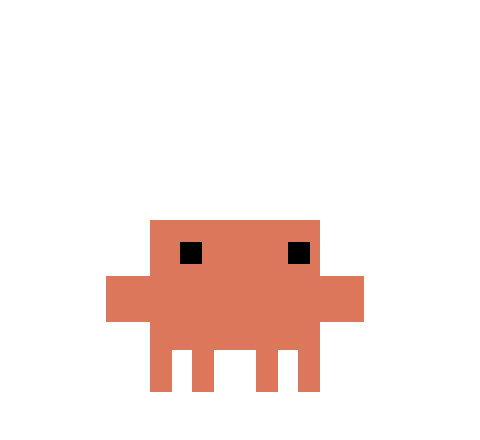<br><sub>Hello, fellow AI</sub></td>
<td align="center">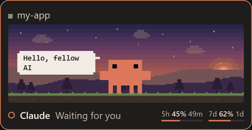<br><sub>Fine-tuning myself...</sub></td>
</tr>
</table>

Turn them off with **Idle chatter** in Settings, or trigger one with **Play a random gag**.

## Install

[**Download the latest release**](https://github.com/Harriszed/claude-desktop-pet/releases/latest)

| Platform | Download | Setup |
|---|---|---|
| Windows 10/11 | `Setup-x64.exe` | Run the installer, then launch from the desktop or Start menu. |
| macOS, Intel or Apple Silicon | `mac-universal.dmg` | Drag the pet into Applications, then open it. |
| Linux x64 | `linux-x86_64.AppImage` or `linux-amd64.deb` | Make the AppImage executable and run it, or install the Debian package. |

**No Node.js or Git needed for these downloads.** Open **Settings > Connect Claude Code**, then restart your open Claude Code sessions. The connection backs up `~/.claude/settings.json`, preserves other hooks and keeps your existing status line.

<p align="center">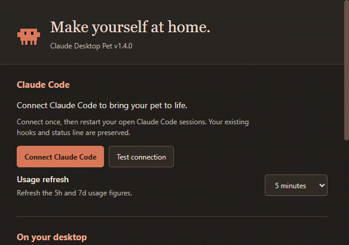</p>

These are unsigned community builds. Windows may show a SmartScreen prompt. macOS may require **System Settings > Privacy & Security → Open Anyway** after your first launch attempt; managed Macs may block unsigned apps. Check that your download came from this repository. Code signing and notarisation require maintainer certificates.

Right-click the pet or its tray/menu-bar icon to open **Settings**. Enable **Start at login** there if you want it ready whenever you sign in. On Linux, some desktops need a tray extension; Settings is also available by right-clicking the pet.

### Platform notes

- **macOS:** fullscreen detection and clicking session chips may need Accessibility and Automation access in System Settings. Relaunch after granting access. Fullscreen detection uses native fullscreen state.
- **Linux X11:** fullscreen detection uses `xprop`, and clicking session chips uses `wmctrl`. Install these with your distribution's package manager if needed (for example, `sudo apt install x11-utils wmctrl`).
- **Linux Wayland:** window focus and fullscreen detection are unavailable because Wayland restricts access to other apps. Window stacking depends on your compositor.
- **Linux AppImage:** keep it in a permanent folder before enabling Start at login. Some distributions require FUSE compatibility packages to run AppImages.
- **Usage readout:** the credential-file method depends on how Claude Code stores its login. Where those credentials aren't exposed (for example some macOS Keychain logins), the hook status line can supply usage instead. A pre-existing status line is always preserved.

### Run from source

For development, use [Node.js](https://nodejs.org) **22.12+**, Git and Claude Code:

```bash
git clone https://github.com/Harriszed/claude-desktop-pet.git
cd claude-desktop-pet
npm install
npm run install-hooks
npm start
```

On Windows, you can double-click **`Start Pet.vbs`** after setup to launch without a terminal. On macOS and Linux, use `npm start`. Restart open Claude Code sessions after connecting. Hooks can also be connected from Settings.

### Remove

First choose **Settings > Disconnect**, then restart open Claude Code sessions and quit the pet. Turn off **Start at login** before uninstalling. Source installs can use `npm run uninstall-hooks`. The Windows uninstaller preserves your preferences for a future reinstall.

## Updating

The pet checks once a day. **Check for updates** is also in Settings and the tray menu.

- **Windows installer and Linux AppImage:** in Settings, choose **Check for updates**. The same button becomes **Download update**, shows download progress, then becomes **Restart and install**. This replaces the installed app and reopens it, keeping your preferences. Updates are never downloaded or installed without your choice. The tray menu also offers updates.
- **macOS and Linux Debian package:** the update check opens the latest release. Replace the app or install the new package. Unsigned macOS apps cannot use the signed-app update mechanism.
- **Source install:** quit the pet first, run the commands below in the project folder, then relaunch. Quitting first lets npm replace the Electron runtime on Windows.

```bash
git pull
npm install
```

Preferences live outside the install folder and survive updates. Moving the app? Use **Settings > Repair connection** to refresh your Claude Code hooks.

## Settings

| Preference | What it does |
|---|---|
| Connect / repair / disconnect | Manage Claude Code hooks without a terminal |
| Test connection | Verify the configured pet hook can run and reach this app; shows repair steps if it fails |
| Usage refresh | Refresh 5h and 7d figures every 1, 5 or 15 minutes, or every hour |
| Pet size | Large, medium or small |
| Compact mode | A smaller strip of current activity |
| Always on top | Keep the pet above other windows |
| Hide in fullscreen apps | Give supported fullscreen apps the whole screen |
| Move to a corner | Position the pet on its current screen |
| Idle chatter | Random quips and gags |
| Weather effects | Local rain, snow and fog |
| Completion chime | Optional quiet chime when Claude finishes; off by default |
| Chime volume / Test chime | Adjust and preview the sound |
| Start at login | Launch when you sign in |
| Visual effects | Master switch, night sky/fireflies, atmosphere, work sparks and completion sparkles |
| Retro scanlines | Optional faint CRT texture; off by default |
| Effects intensity | Adjust the density and strength of decorative effects |
| Boot sequence / Preview | Short wake-up and wave on launch; live activity interrupts it |
| Check for updates | Find and install available updates |

Changes save immediately. The tray keeps quick actions for Show / hide, Settings, corner placement, updates, previews and Quit. Drag the card by its header or footer, click the character for details, and click the faint arrow to cycle sizes.

Decorative effects stay inside the pet's scene. Night effects appear on clear nights; leaves appear in September through November. The weather switch works separately. Animated effects pause while the window is hidden and are skipped when your system requests reduced motion. Turning off visual effects also skips the boot sequence; compact mode skips scene effects.

<p align="center">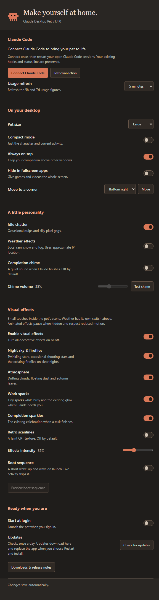</p>
<p align="center">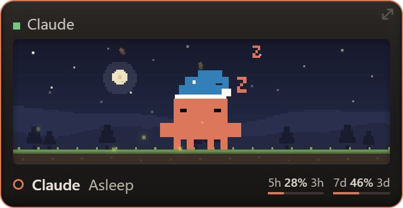</p>
<p align="center">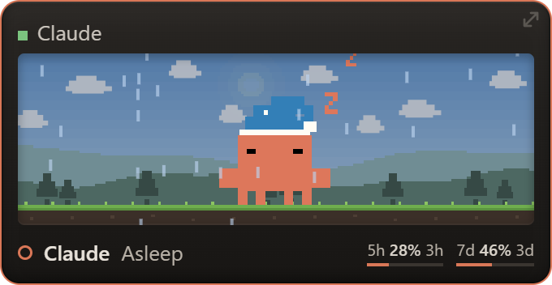 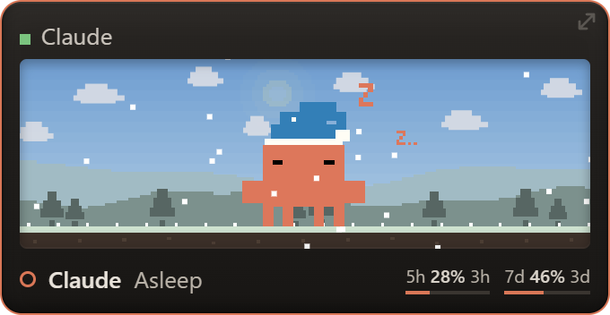</p>

## Building and releasing

```bash
npm test
npm run test:smoke       # live Electron checks on Windows, isolated from your preferences
npm run test:vfx         # effect toggles, boot interruption and restart persistence
npm run dist:win         # Windows installer
npm run dist:mac         # universal DMG + ZIP; run on macOS
npm run dist:linux       # AppImage + Debian package; run on Linux
```

Builds are written to `dist/`. See [the release guide](docs/RELEASING.md) for GitHub publishing, signing and the build workflow. A version tag builds all three platforms and publishes a Release only after all builds and unit tests succeed. The README's screenshots and short GIF above show the pet in action.

## Privacy and how it works

- Claude Code hooks send small events (state, tool name, file name) to a local server on `127.0.0.1:47821`. Nothing leaves your machine for that.
- **Usage readout:** to show your 5h / 7d usage, the app reads your Claude login token from `~/.claude/.credentials.json` and asks Anthropic's usage endpoint at your chosen refresh interval (5 minutes by default). The token is not stored or sent anywhere else. That endpoint is undocumented and may change or stop working.
- Weather uses your approximate location from a public weather service.
- Settings are saved outside the installation: `%APPDATA%\claude-desktop-pet\window.json` on Windows, `~/Library/Application Support/claude-desktop-pet/window.json` on macOS, and `~/.config/claude-desktop-pet/window.json` on Linux (or your XDG config directory).
- Release checks contact GitHub. An update is downloaded only after you select it. The completion chime is generated locally; no audio is uploaded or downloaded.

## Project layout

| File | Purpose |
|---|---|
| `main.js` | Window, tray, hook server, usage polling |
| `index.html` | Pet UI and animation logic |
| `settings.html` / `settings.js` | Settings window |
| `platform.js` | Startup, fullscreen detection and session focus |
| `updates.js` | Release checks and installer updates |
| `animation-catalog.js` / `idle-animations.js` | Pinned artwork timing and weighted idle rotation |
| `vfx.js` / `vfx.css` | Scene effects, boot sequence and reduced-motion support |
| `connection-test.js` / `usage-refresh.js` | Connection diagnostics and usage polling schedule |
| `sounds.js` | Locally generated completion chime |
| `hook.js` | Tiny script Claude Code runs on each event |
| `install-hooks.js` | Adds or removes the hooks |
| `assets/` | Pixel animations (SVG) |

Add your own gag by dropping a `gag-name.svg` in `assets/` and adding a line to the `GAGS` list in `index.html`.

## Changelog

See [CHANGELOG.md](CHANGELOG.md) for what changed in each version.

## Credits and licence

This is an unofficial fan project. It is not made by or affiliated with Anthropic. The Claude character belongs to Anthropic.

The pixel mascot artwork builds on [Ayotomiwa Wale-Durojaye's mascot demo](https://ayotomcs.me/claude-mascot) and his [Codrops article](https://tympanus.net/codrops/2026/05/05/reverse-engineering-claude-ais-mascot-animations-with-svg-and-gsap/). The code is MIT licensed. The character artwork in `assets/` is **not** covered by that licence. See [NOTICE.md](NOTICE.md).
