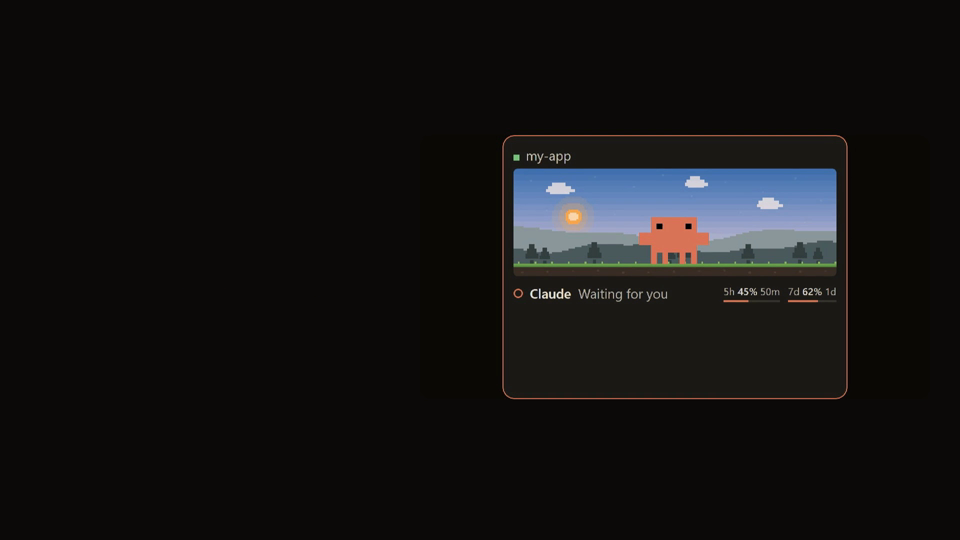
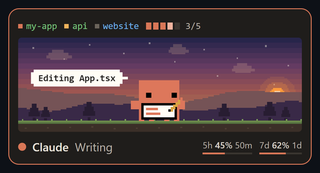

<h1 align="center">Claude Desktop Pet</h1>

<p align="center">
  A tiny pixel Claude that lives on your desktop and reacts to everything <a href="https://claude.com/claude-code">Claude Code</a> is doing.<br>
  Thinking, reading, writing, running tests, failing, finishing, or just waiting for you.
</p>

<p align="center">
  
</p>

<p align="center">
  <a href="docs/promo.mp4"></a><br>
  <sub>Watch the 27-second promo</sub>
</p>

<p align="center">
  
  
  
</p>

## What it does

A small always-on-top card sits in the corner of your screen. Whatever Claude Code is up to, the pet acts it out, with a speech bubble saying what it's touching right now.

<p align="center"></p>

- **Runs off your Claude Code hooks.** It just listens, no file watching.
- **Speech bubbles** show the current action (`Editing App.tsx`, `npm test`, `Build failed`).
- **Multiple sessions.** Several Claude Code windows show as coloured chips; click one to jump to that window.
- **Task progress.** A little bar follows Claude's to-do list.
- **Usage at a glance.** 5-hour and 7-day usage with time until reset.
- **Context warning.** Tells you when a session's memory is nearly full.
- **Sub-agents.** Helpers appear as tiny Claudes underneath; click one for details.
- **Local weather and time of day** change the scenery behind it.
- **Random gags.** Every so often, when idle, it does something silly. See below.

<p align="center"></p>

## Random gags

When Claude is idle, it occasionally does an AI-flavoured bit. Ten so far:

<table align="center">
<tr>
<td align="center"><br><sub>Coffee. Always coffee.</sub></td>
<td align="center"><br><sub>Deploying to prod...</sub></td>
</tr>
<tr>
<td align="center"><br><sub>*ships it*</sub></td>
<td align="center"><br><sub>Buffering...</sub></td>
</tr>
<tr>
<td align="center"><br><sub>Totally real. Trust me.</sub></td>
<td align="center"><br><sub>Counting tokens...</sub></td>
</tr>
<tr>
<td align="center"><br><sub>Context window: feeling full</sub></td>
<td align="center"><br><sub>Thinking really hard...</sub></td>
</tr>
<tr>
<td align="center"><br><sub>Hello, fellow AI</sub></td>
<td align="center"><br><sub>Fine-tuning myself...</sub></td>
</tr>
</table>

Turn them off with **Idle chatter** in the tray menu, or trigger one with **Play a random gag**.

## Install

You need [Node.js](https://nodejs.org) 18+ and Claude Code on **Windows**.

```bash
git clone https://github.com/Harriszed/claude-desktop-pet.git
cd claude-desktop-pet
npm install
npm run install-hooks   # adds the hooks to ~/.claude/settings.json (a backup is saved first)
npm start
```

Restart any open Claude Code sessions so they pick up the hooks. Then right-click the tray icon and tick **Start with Windows** if you want it always there.

To remove it: `npm run uninstall-hooks`, then quit from the tray menu.

## Tray menu

| Option | What it does |
|---|---|
| Show / hide | Toggle the pet |
| Compact | Smaller version, just the character |
| Idle chatter | Random quips and gags while idle |
| Weather effects | Rain, snow and fog from your local weather |
| Hide in fullscreen apps | Gets out of the way of games and videos |
| Snap to corner | Move to any screen corner |
| Start with Windows | Launch at login |
| Play a random gag | See one right now |
| Preview animation / weather | Try any state or weather |

You can also drag the card anywhere and click the character for details.

<p align="center"></p>

## Privacy and how it works

- Claude Code hooks send small events (state, tool name, file name) to a local server on `127.0.0.1:47821`. Nothing leaves your machine for that.
- **Usage readout:** to show your 5h / 7d usage, the app reads your Claude login token from `~/.claude/.credentials.json` and asks Anthropic's usage endpoint for your limits every couple of minutes. The token is not stored or sent anywhere else. That endpoint is undocumented and may change or stop working.
- Weather uses your approximate location from a public weather service.
- Settings are saved in `%APPDATA%\claude-desktop-pet\window.json`.

## Project layout

| File | Purpose |
|---|---|
| `main.js` | Window, tray, hook server, usage polling |
| `index.html` | The whole pet UI and animation logic |
| `hook.js` | Tiny script Claude Code runs on each event |
| `install-hooks.js` | Adds or removes the hooks |
| `assets/` | Pixel animations (SVG) |

Add your own gag by dropping a `gag-name.svg` in `assets/` and adding a line to the `GAGS` list in `index.html`.

## Credits and licence

This is an unofficial fan project. It is not made by or affiliated with Anthropic. The Claude character belongs to Anthropic.

The pixel mascot artwork builds on [Ayotomiwa Wale-Durojaye's mascot demo](https://ayotomcs.me/claude-mascot) and his [Codrops article](https://tympanus.net/codrops/2026/05/05/reverse-engineering-claude-ais-mascot-animations-with-svg-and-gsap/). The code is MIT licensed. The character artwork in `assets/` is **not** covered by that licence. See [NOTICE.md](NOTICE.md).
